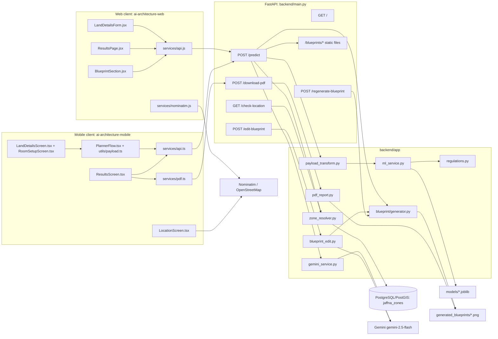
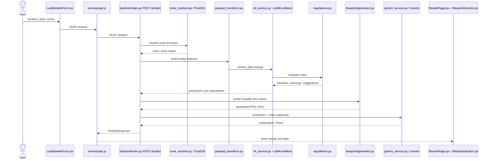
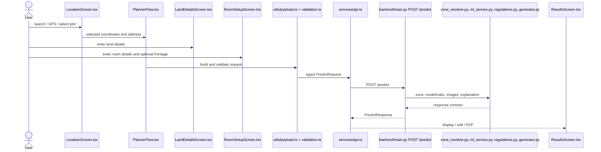
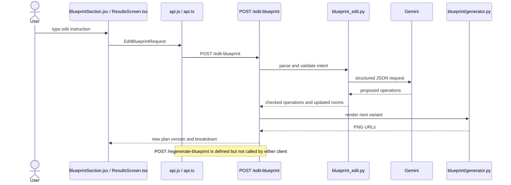
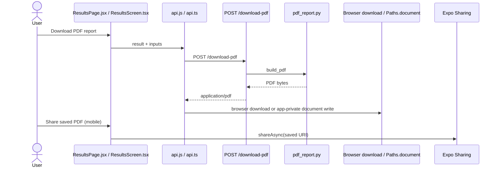

# AI-Assisted Architecture Planning System — Full Codebase Analysis

> **Purpose:** Help users check a Jaffna plot, estimate planning feasibility, and view/edit generated floor plans. **Stack:** Python 3.13.14; FastAPI 0.115.0, Uvicorn 0.30.6, Pydantic 2.9.2, scikit-learn 1.6.1, XGBoost 2.1.1, pandas 2.2.3, NumPy 2.4.4, joblib 1.4.2, Google GenAI 1.73.1 (unversioned in requirements); PostgreSQL/PostGIS (external version not confirmed); React 19.2.7 + Create React App 5.0.1 web; Expo SDK 58.0.26, React Native 0.88.1, React 19.3.0, TypeScript 6.0.3 mobile; Node 24.14.0/npm 11.9.0. **Audit date:** 2026-11-19. **Size:** 139 Git-tracked files; the initial on-disk map had 161 files / 40 folders after excluding dependency/build directories. Tracked code-extension line counts: backend 4,460; web 2,600; mobile 5,325. Counts exclude docs, manifests, locks, and assets.

## 1. Project Overview

- The system accepts a location, plot measurements/shape/road details, building purpose, floors, room counts, and notes. The mobile app also supports recent locations and a GPS/map flow. Evidence: `backend/app/schemas.py:50-91`, `ai-architecture-web/src/pages/LandDetailsForm.jsx:300-461`, `ai-architecture-mobile/src/features/planner/PlannerFlow.tsx:30-163`.
- Main user flow:
  1. Choose/search a plot location; optionally use GPS. The backend checks the point against Jaffna PostGIS polygons. Evidence: `ai-architecture-web/src/components/MapPicker.jsx`, `ai-architecture-mobile/src/features/planner/LocationScreen.tsx:100-160`, `backend/app/zone_resolver.py:81-148`.
  2. Enter plot and room details. Both clients convert feet to metres and send a typed request; mobile validates before posting. Evidence: `ai-architecture-mobile/src/utils/payload.ts:51-107`, `ai-architecture-mobile/src/utils/validation.ts:151-252`.
  3. `/predict` combines PostGIS zoning, model prediction, and UDA rules; when feasible it renders PNG floor plans and requests an optional Gemini explanation. Evidence: `backend/main.py:60-107`, `backend/app/ml_service.py:90-235`.
  4. Review feasibility, confidence, permitted/requested floor area, zone, rule blockers/warnings/suggestions, explanation, and per-floor plans. Evidence: `ai-architecture-web/src/pages/ResultsPage.jsx:70-220`, `ai-architecture-mobile/src/features/planner/ResultsScreen.tsx:190-250`.
  5. Edit a plan in natural language and retain prior versions; request a PDF. Evidence: `backend/main.py:140-215`, `backend/app/blueprint_edit.py`, `backend/app/pdf_report.py:238-310`.
- Numbered outputs: (1) feasibility and confidence, (2) layout and structure classifications with confidence, (3) area/FAR calculations, (4) zone and area match, (5) rule blockers/warnings/suggestions, (6) floor-by-floor PNGs, (7) optional explanation, and (8) downloadable PDF. Evidence: `backend/app/schemas.py:99-124`, `backend/main.py:102-107,140-150`.
- **Boundary:** This tool provides planning estimates, not an approval or construction-ready architectural design. The code does not establish that its zoning polygons or rule tables are the current authoritative legal source.

## 2. Architecture Diagram

The actual routes are registered in `backend/main.py`; the diagram includes all six JSON routes (including health) and static blueprint serving. PostGIS is external to this repository; no schema, migration, seed SQL, or database version is tracked.

## 3. File-by-File Breakdown

### 3.1 Backend

#### `backend/main.py` — FastAPI startup and routes
- Creates the app, wildcard CORS middleware, and `/blueprints` static mount (`:27-41`).
- Routes: `/` health; `/check-location`; `/predict`; `/regenerate-blueprint`; `/download-pdf`; `/edit-blueprint` (`:44-215`).
- `/predict` flow: 1. validate `PredictRequest`; 2. resolve zone and area; 3. transform and run model/rules; 4. render blueprints if feasible; 5. aggregate rooms again; 6. request explanation; 7. serialize `PredictResponse`.
- **NOTE:** `aggregate_rooms(request)` runs at both `:71` and `:90`.
- **CAUTION:** broad handlers return raw exception text for several 500/503 responses (`:109-110,132-133,149-150,176-177,206-207`).

#### `backend/app/schemas.py` — Request/response validation
- Pydantic types cover room modes, three room payload layouts, location, land, purpose, optional frontage, extra roads, and responses (`:10-125`).
- `roadFrontage` is nullable, positive and finite when set. Coordinate bounds and finite land measurements are enforced.
- Backend `RoomConfig.bathrooms` defaults to **1** (`:12-18`); current clients explicitly default/send **0**. This mismatch is latent when clients omit a room field.
- `PredictResponse.area_name` is required (`:124`); `/predict` supplies it from the model result.

#### `backend/app/payload_transform.py` — Request-to-model transformation
- `_expand_to_per_floor()` expands `same`, `standardWithOverrides`, and `perFloor`; `aggregate_rooms()` totals model rooms and produces a floor breakdown (`:18-85`).
- `build_predict_plan_kwargs()` assembles model inputs (`:88-122`).
- **WARNING:** absent frontage is replaced with `request.landLength` (`:108-111`), so “optional/unknown” is not represented as unknown to ML and rule evaluation.

#### `backend/app/ml_service.py` — ML inference and rule override
- Loads five joblib artifacts at service initialization (`:29-48`); assembles/reindexes feature data and predicts feasibility/layout/structure.
- `predict_plan()` calls `evaluate_rules()` (`:90-123`); rules populate blockers, warnings, suggestions and can override feasibility (`:214-235`).
- Unknown encoded categories are logged and mapped to encoder class index zero (`:56-86`); this can silently turn an unfamiliar area/category into another category.
- **CAUTION:** loading pickled/joblib model objects executes Python serialization logic. Artifacts were not deserialized during this audit; only names/metadata were inspected.

#### `backend/app/regulations.py` — UDA rule logic and lookup tables
- Contains Form A FAR tables, Form B road/floor limits, coverage caps, and `evaluate_rules()` (`:55-399`).
- Tests cover 9 m non-residential access, CN3 50% coverage, FAR bands, and floor limits (`backend/tests/test_regulations.py`).
- **Needs confirmation:** suspected Form A numeric typos cannot be confirmed without the authoritative source table. `4.5` appears in multiple table cells and as a road threshold; no authoritative PDF was present in the repository. No `110.0` literal was confirmed in this file.

#### `backend/app/zone_resolver.py` — PostGIS lookup
- Reads `jaffna_zones` with parameterized `ST_Contains` queries (`:81-148,150-174`); coordinate order is `(lng, lat)`.
- Explicitly rejects outside-map points, waterbodies, and unmapped zones; it does not silently select zone index zero.
- Connection defaults are localhost/PostgreSQL and an empty password sourced from environment (`:35-39`). Empty credentials are not validated at startup.
- `psycopg2` is imported at `:26`, but its distribution is absent from `backend/requirements.txt`.

#### `backend/app/zone_data.py` — Zone constants
- Supplies UDA zone metadata consumed by resolver and regulations. It is an in-code lookup, not a versioned database table.

#### `backend/app/area_names.py` — Address-area matching
- Resolves address components to known model categories and reports whether a match was made. Unrecognized names use a fallback category; the response surfaces `area_matched`.

#### `backend/app/blueprint/generator.py` — PNG layout generation and disk cache
- Builds a deterministic cache key and stores PNGs in `backend/generated_blueprints` (`:30-60,425-506`); returns an existing file for a cache hit.
- Coordinates footprint, extra roads, corridor layout, treemap, room drawing, and all-floor output (`:60-81,425-525`).
- **WARNING:** generated PNG cache has no eviction or age/size limit.
- **Known limitation:** L-shaped plots use the old treemap split without a corridor spur (`:79-81`).
- Imports matplotlib at module load (`:13-16`); matplotlib is absent from `requirements.txt`.

#### `backend/app/blueprint/corridor_layout.py` — Corridor-oriented plan layout
- Computes room placement around corridors for supported footprints; called by the generator for the non-L path.

#### `backend/app/blueprint/extra_roads.py` — Corner/extra-road geometry
- Normalizes road labels/sides and computes boundary/road markings used by layout rendering.

#### `backend/app/blueprint/footprint.py` — Plot footprint geometry
- Computes footprints and usable area for supported plot shapes; validates with math helpers.

#### `backend/app/blueprint/room_config.py` — Room sizing and fallback
- Derives room shapes/counts and room-tweak sizing used by blueprint rendering.
- When all requested counts are zero, generator supplies a fallback open-space room; zero-room requests are accepted rather than rejected.

#### `backend/app/blueprint/treemap.py` — Treemap partitions
- Provides the geometric room partition helper used by legacy/L-shaped layouts.

#### `backend/app/blueprint_edit.py` — Validated LLM edit interpreter
- Prompts Gemini to translate an instruction, parses JSON, checks room counts/floors/doors/room tweaks, and applies only allowed changes (`:1-364`).
- Edit instructions are capped to 500 characters in the route; parsed operations are bounded by per-floor room limits.

#### `backend/app/gemini_service.py` — Optional explanation service
- Loads `GEMINI_API_KEY`, uses `gemini-2.5-flash`, builds a prompt from predictions/notes, and returns `None` if the provider is unavailable (`:27-155`).
- Prompt says user notes are data, not instructions (`:63-68`).
- **CAUTION:** no explicit request timeout/retry is set; user `notes` has no schema length limit. A provider failure is logged and silently removes the explanation from an otherwise successful result.

#### `backend/app/pdf_report.py` — PDF report generation
- Uses ReportLab and optional generated blueprint images to produce a PDF (`:14-19,238-310`).
- `reportlab` is imported here but is absent from `backend/requirements.txt`.

#### `backend/build_dataset.py` — Dataset builder
- Builds rule-labeled examples from an external CSV and `evaluate_rules()`; the input dataset is not tracked.
- No training/evaluation workflow, metric report, dataset, or notebook is checked into this repository; README points to an external Colab flow.

#### `backend/requirements.txt` — Backend package manifest
- Pins FastAPI, Uvicorn, Pydantic, sklearn, XGBoost, joblib, pandas, NumPy range, and dotenv; `google-genai` is unpinned.
- **HIGH:** omits runtime imports `psycopg2`, matplotlib, and ReportLab. A clean install from this file is not a reproducible backend installation.

#### `backend/test_zone.py` — Standalone DB smoke test
- Calls PostGIS at module import and unpacks two values from a function returning three (`:1-4`).
- **WARNING:** full `pytest` collection imports this module and attempts a DB connection; it is not isolated behind a test marker or `if __name__ == "__main__"`.

#### `backend/tests/`
- `test_schemas.py`: request bounds, finite values, room counts, floor-key canonicalization, parking and variants.
- `test_regulations.py`: business-rule tables and rule outcomes.
- `test_predict_api.py`: prediction contract, mocked zoning, outside-Jaffna/waterbody errors, road blockers, CN3 and area matching; two live PostGIS tests skip without DB credentials.
- `test_other_endpoints.py`: edit and PDF response flows.
- `QA_REPORT.md`: prior QA notes; its recorded date/results are not a substitute for the current audit runs.

#### `backend/.gitignore`, `backend/app/__init__.py`
- `.gitignore` ignores `.env`; package initializer is empty.

#### `backend/models/*.joblib` and `backend/generated_blueprints/*.png`
- Three model artifacts plus encoder and feature-column artifacts are present; nine generated floor PNGs were present at audit time.
- Binary contents were intentionally not opened. The model artifacts are Python-serialization files; PNGs are output/cache data, not source.

### 3.2 ML / Data Pipeline

- Training and serving: `backend/build_dataset.py` creates rule-labeled input; `backend/app/ml_service.py` loads pretrained sklearn/XGBoost classifiers and encoders. No checked-in training script, notebook, dataset, artifact provenance, evaluation metrics, or CI retraining job exists.
- Serving feature names include `Area_Name`, `Road_Frontage_m`, room counts, zoning, and land data (`ml_service.py:135-178`). Rules are evaluated from the same request and can override the model result (`:119-123,214-235`).
- **WARNING — reproducibility:** no artifact version metadata or training commit is checked in. The model files were not deserialized for safety. The installed XGBoost emitted a serialized-model compatibility warning during testing; source model version is unknown.
- **Training/serving skew risk:** `build_dataset.py` and inference code are separate paths; there is no automated feature-parity or evaluation check. Unrecognized encoded categories fall back to index 0.
- **Data leakage/class imbalance/metrics:** not checked—source training data and evaluation workflow are absent.

### 3.3 Database / GIS

- `backend/app/zone_resolver.py` expects an external PostGIS `jaffna_zones` table with a `geom` geometry column (`:88-94,151-157`). SQL is parameterized; no SQL injection pattern was found in the query.
- `backend/app/zone_data.py` holds the in-code zone/rule metadata; `area_names.py` maps address text to model categories.
- No schema, migration, seed file, GIS source map, PostGIS version, or DB provisioning script is tracked. Table correctness and polygon currency could not be independently verified.
- Two real-PostGIS tests are skipped when the password is unavailable. The root-level `backend/test_zone.py` makes full-suite collection attempt a live connection and has a stale return-value unpack.

### 3.4 Web Frontend

#### Entry, routing, and shared UI
- `ai-architecture-web/src/index.js`: React root and test setup.
- `src/App.js`: page-level flow between Home, form, and result.
- `src/App.css`, `src/index.css`: global styling.
- `src/logo.svg`: logo asset.
- `src/reportWebVitals.js`: CRA performance-report helper.
- `src/App.test.js`, `src/setupTests.js`: starter app test and Jest setup; the current test command fails before running tests due to ESM parsing of `react-leaflet`.

#### Pages and components
- `src/pages/Home.jsx`: start/continue entry.
- `src/pages/LandDetailsForm.jsx`: location and land/building/rooms wizard, validation and request construction; **1,034 lines**.
- `src/pages/ResultsPage.jsx`: result, rules, explanation, PDF, and result navigation. A stray literal `3` is rendered near line 162.
- `src/components/MapPicker.jsx`: Leaflet map and location selection.
- `src/components/BlueprintSection.jsx`: floor plans, edit requests, version history.

#### Services and utilities
- `src/services/api.js`: `fetch` calls for prediction, location, PDF, edits; errors are parsed into readable messages. **CAUTION:** API base defaults to `http://localhost:8000` (`:4`), which is not the developer computer from a physical phone.
- `src/services/nominatim.js`: OpenStreetMap search/reverse geocode; no central throttle/cache or explicit timeout was found.
- `src/utils/jaffnaBounds.js`: geographic bounds helper.

#### Web behavior and confirmed defect
- Room counts start at zero and floors at one (`LandDetailsForm.jsx:23-29,322`); new custom floors copy standard rooms (`:344,372,388`).
- Road frontage is displayed with “Road Frontage (unit) - optional” and the same hint used by mobile (`:860-876`), and is sent as metres or `null` (`:461`).
- **Confirmed validation gap:** `validateStep1()` checks frontage at `:420-424`, but `handleNext()` invokes it only while `step === 0` (`:430-432`). The frontage field is shown later in the room step (`:860-876`), and final submit does not validate it (`:441-461`). Thus a typed invalid value can reach the request and become a backend 422 rather than the intended form error.
- Zero room counts are accepted; no all-zero warning is shown. Mobile currently matches this behavior.

### 3.5 Mobile App

#### Entry and app shell
- `src/app/_layout.tsx`: Expo Router stack shell.
- `src/app/index.tsx`: planner app entry.
- `src/app/explore.tsx`: starter explore screen; not part of the main planning flow.
- `src/global.css`, `src/constants/theme.ts`: starter/global theme definitions; planner screen styles use fixed colors.
- `app.config.ts`: Expo plugins and runtime `API_BASE_URL`; requests only foreground/while-in-use location permission.
- `app.json`: portrait-only orientation and Android predictive-back gesture disabled (`:6,19`).

#### Planner screens and state
- `src/features/planner/LocationScreen.tsx`: geocoding, GPS permission flow, map and recent-location selection.
- `src/features/planner/LandDetailsScreen.tsx`: land dimensions, units, road type, plot shape, extra-road details.
- `src/features/planner/RoomSetupScreen.tsx`: room modes/counters and optional frontage after notes; new per-floor rooms use zero defaults.
- `src/features/planner/PlannerFlow.tsx`: holds draft state across steps, builds request, preserves state when navigating back/forward, and resets all state on New Plan.
- `src/features/planner/ResultsScreen.tsx`: results, plan history, edit/regenerate action, PDF download/share.
- `src/features/planner/types.ts`: `DEFAULT_ROOMS` are all zero; default floors is one (`:41-70`).
- `src/features/planner/components.tsx`: shared planner controls/cards/counters.

#### Mobile services, types, and tests
- `src/services/api.ts`: Axios API client, validates request and maps status/network errors; refuses an unset API base instead of falling back to localhost.
- `src/services/pdf.ts`: verifies `%PDF-`, writes to `Paths.document`, shares via Expo Sharing. **CAUTION:** the `File.write()` Promise is not awaited (`:30`); success can be reported before a completed write/error.
- `src/types/api.ts`: TypeScript request/response definitions; request and prediction-response fields match backend names/types. `parkingSpaces` is represented and sent as zero but has no UI control. Backend defaults bathroom to one only when omitted, while mobile sends zero.
- `src/utils/payload.ts`: converts feet to metres, computes sqm/perch, normalizes floor keys, supplies optional fields.
- `src/utils/validation.ts`: bounds/finite checks, room/floor validation, and frontage validation.
- `tests/api.test.ts`, `payload.test.ts`, `validation.test.ts`, `screens.test.tsx`, `flow.test.tsx`, `results.test.tsx`, `pdf.test.ts`, `fixtures.ts`: seven Jest suites cover pure logic, API mocks, screens, edit/results, and PDF signature.
- `services/nominatim.js`: used by LocationScreen; Axios requests have no explicit timeout/throttle/cache.
- Starter files: `src/components/animated-icon.module.css`, `animated-icon.tsx`, `animated-icon.web.tsx`, `app-tabs.tsx`, `app-tabs.web.tsx`, `external-link.tsx`, `hint-row.tsx`, `themed-text.tsx`, `themed-view.tsx`, `ui/collapsible.tsx`, `web-badge.tsx`, `src/hooks/use-color-scheme.ts`, `use-color-scheme.web.ts`, `use-theme.ts`, `src/types/styles.d.ts`. The two tab files and `use-theme.ts` cause current TypeScript errors; these are not the core planner screen.
- `src/constants/architecture.ts`: conversion factors and shared option tables.
- `scripts/reset-project.js`: starter reset utility deletes or moves the entire `src` and `scripts` directories; running its `reset-project` script against this customized app would be destructive.
- `services/nominatim.d.ts`: legacy JavaScript service type declarations.
- `src/components/ui/*` and image/icon assets are starter UI/artwork; image binaries were inventoried but not visually audited.

### 3.6 Config / Infra / Tests / Documentation

- `ai-architecture-mobile/package.json`, `package-lock.json`: Expo SDK 58 app, Jest setup, test script, and dependency lock.
- `ai-architecture-mobile/jest.config.js`, `tsconfig.json`, `expo-env.d.ts`: test, TypeScript, and Expo generated-type settings.
- `ai-architecture-mobile/.env.example`, `.gitignore`: API URL template; `.env` is ignored.
- `ai-architecture-mobile/README.md`, `WEB_LOGIC_MAP.md`, `MOBILE_QA_PLAN.md`: project and QA docs; QA plan/logic map still claim no runner and initial default values despite tests/defaults now existing.
- `ai-architecture-mobile/.claude/settings.json`, `.vscode/extensions.json`, `.vscode/settings.json`, `AGENTS.md`, `CLAUDE.md`, `LICENSE`: editor/agent/license configuration.
- `ai-architecture-web/package.json`, `package-lock.json`, `.gitignore`: CRA manifest/lock and ignore rules.
- `ai-architecture-web/public/index.html`, `manifest.json`, `robots.txt`: web document/PWA metadata. `favicon.ico`, `logo192.png`, `logo512.png` are binary assets.
- `ai-architecture-web/README.md`: setup and feature documentation; stale claims say throttling/cache exist and mobile is not started.
- `backend/.gitignore`, `backend/README.md`, `backend/requirements.txt`: backend config/docs/dependencies.
- `pytest.ini`: root test marker/config. No GitHub Actions/CI workflow or container/deployment manifest is tracked.

### Endpoint and schema tables

| Route | File | Purpose |
|---|---|---|
| `GET /` | `backend/main.py:44-46` | Health/status |
| `GET /check-location` | `backend/main.py:49-57` | Confirm a point is in a buildable mapped zone |
| `POST /predict` | `backend/main.py:60-110` | Zone lookup, model/rules, blueprints, explanation |
| `POST /regenerate-blueprint` | `backend/main.py:112-134` | Generate a selected layout variant |
| `POST /download-pdf` | `backend/main.py:140-150` | Create PDF report |
| `POST /edit-blueprint` | `backend/main.py:168-215` | Parse/edit/re-render plan |
| `GET /blueprints/{filename}` | `backend/main.py:39-41` | Serve generated PNGs |

#### Flow inside `GET /`
1. Return static API status JSON.

#### Flow inside `GET /check-location`
1. Query PostGIS by `(lng, lat)`.
2. Return zone name, or a clear 400 for outside/waterbody; unexpected DB errors become a generic 500.

#### Flow inside `POST /predict`
1. Pydantic validates `PredictRequest`.
2. Resolve zone/area via PostGIS.
3. Build model kwargs; predict and evaluate regulations.
4. If feasible, aggregate rooms and render per-floor PNGs.
5. Aggregate rooms again, call Gemini explanation, build `PredictResponse`.
6. Map `ValueError` to 400; other exceptions currently include raw text in a 500.

#### Flow inside `POST /regenerate-blueprint`
1. Convert floor configs and call generator with the requested variant modulo 3.
2. Return PNG URLs and `variant_used`; this endpoint has no web/mobile client call in the current tracked source.

#### Flow inside `POST /edit-blueprint`
1. Trim/cap the instruction at 500 characters and reject empty text.
2. Ask Gemini for structured edits; parse and validate allowable operations.
3. Apply bounded changes, merge doors, render a variant, and return breakdown/URLs.
4. The client uses this route for its “Regenerate blueprint” action; the route name is not the same as the separate unused regenerate endpoint.

#### Flow inside `POST /download-pdf`
1. Accept result/inputs JSON.
2. Build the report and include generated images if available.
3. Return `application/pdf`; broad error response includes exception text.

| Schema | Important contract |
|---|---|
| `PredictRequest` | `lat/lng` bounded finite; positive finite plot dimensions/areas/road width; optional positive finite frontage; shape/purpose/layout literals; floors 1–15; room discriminator; up to 3 extra roads; `parkingSpaces >= 0`; notes default empty. |
| `RoomConfig` | Integer nonnegative counts; backend bathroom default 1 differs from client default 0 when omitted. |
| `PredictResponse` | Prediction/confidence and area fields; zone fields; required `area_name`; optional blueprints/explanation/floor breakdown; rule lists default empty; `area_matched` default true. |
| Edit/PDF requests | Edit request fields are less constrained than `PredictRequest`; PDF `result`/`inputs` are generic dictionaries at the route boundary. |

| Room mode | Behavior |
|---|---|
| `same` | One `RoomConfig` is repeated for each floor. |
| `standardWithOverrides` | Standard room counts are used on every floor except explicitly keyed overrides; numeric keys are canonicalized. |
| `perFloor` | One config per floor; backend defensively pads/trims to match the floor count. |

**Mobile contract result:** `src/types/api.ts` fields match the backend prediction request/response names and numeric/string/list shapes reviewed. JSON integer floor keys become strings as expected. `parkingSpaces` is sent as `0` with no control. Edit request/response matches. Separate `/regenerate-blueprint` response has `variant_used`, but no client invokes it. No critical request/response field mismatch was confirmed.

## 4. Data Flow Summary

### Web prediction sequence

### Mobile prediction sequence

### Edit and regenerate sequence

### PDF download and share sequence

## 5. Web vs Mobile Parity

| Feature | Web | Mobile | Status |
|---|---|---|---|
| Form defaults | Floors 1; rooms 0 | Floors 1; rooms 0 | Done |
| New per-floor defaults | Custom floors copy standard-room values | Added per-floor entries copy zero defaults | Partial; mobile meets the requested zero-start behavior, web differs after user edits standard counts |
| Back/forward state | Form remains mounted when hidden | Draft stays in `PlannerFlow` | Done |
| Building purpose | Hides some controls; does not reset hidden counts | Hides bedroom/kitchen controls; does not reset values | Done |
| Location picker | Leaflet and Nominatim | Map/GPS, Nominatim, recent locations | Partial; platform-specific UX and no physical-device QA |
| Road frontage position | Bottom of room step, after notes | Bottom of Room Setup, after notes | Done |
| Road frontage label/hint | Optional label; same hint | Same label/hint | Done |
| Road frontage validation | Check is wired to the prior land step and is not rerun after entry | Validated before request submission | **Partial/bug on web** |
| All rooms zero | Accepted; no warning | Accepted; no warning | Done |
| Request payload | Sends optional frontage as `null` or metres | Same; validates finite positive value | Done, but backend substitutes land length for missing frontage in ML inputs |
| Feasibility/rules | Shows blockers, warnings, suggestions | Shows blockers, warnings, suggestions | Done |
| Blueprint edit/history | Text edit, response versions, previous/next | Text edit, response versions, previous/next | Done |
| Separate variant regeneration | No caller found for `/regenerate-blueprint` | No caller found; “Regenerate” is the edit route | Missing as a separate user action |
| PDF download | Browser downloads a named PDF | Writes to app-private documents, then shares | Partial; mobile file is not in public Downloads |
| Error handling | Readable fetch errors; localhost fallback | Readable Axios errors; no localhost fallback | Partial; web fallback is unsuitable on phones |
| Dark mode | Mostly fixed light styles | Planner uses fixed light colors despite automatic app setting | Missing/incomplete |

## 6. Status of Previous Issues

| Previous issue | File | Status |
|---|---|---|
| `evaluate_rules()` never called from `/predict` | `backend/app/ml_service.py:119` | **Fixed/not present:** `predict_plan()` calls it; rule results are returned at `:230-232`. |
| Suspected FORM_A typos (`4.5`, `110.0`) | `backend/app/regulations.py:55-250` | **Needs confirmation:** no authoritative UDA source in repo; `4.5` is present and plausible; no `110.0` was confirmed. |
| `aggregate_rooms()` called twice | `backend/main.py:71,90` | **Still present.** |
| `PredictResponse.area_name` has no default | `backend/app/schemas.py:124` | **Still required, but supplied** from `result` in `/predict`; not a confirmed missing-response bug. |
| Zone resolver silently falls back to index zero | `backend/app/zone_resolver.py:103-145` | **Fixed/not present for zones:** unmapped zones raise. ML category encoding still has logged index-zero fallback in `ml_service.py:56-86`. |
| Empty DB password default | `backend/app/zone_resolver.py:35-39` | **Still present as configuration default.** No secret is hardcoded; a missing password is not rejected at startup. |
| L-shaped layout has no corridor spur | `backend/app/blueprint/generator.py:79-81` | **Still present and documented in code.** |
| Mobile app was a skeleton | `ai-architecture-mobile/src/features/planner/*` | **Changed:** complete location/land/rooms/results flow, API, tests, edits, and PDF exist. Starter components remain. |
| Unbounded blueprint PNG cache | `backend/app/blueprint/generator.py:425-506` | **Still present:** deterministic disk files, no eviction observed. |
| CORS `allow_origins=["*"]` | `backend/main.py:29-36` | **Still present.** |
| 1,034-line LandDetailsForm | `ai-architecture-web/src/pages/LandDetailsForm.jsx` | **Still present** (1,034 lines). |
| `build_dataset.py` not in CI | `backend/build_dataset.py` | **Still not wired:** no CI workflow is tracked. |

## 7. Issues & Gaps Found

Severity reflects likely impact, not certainty of exploitation. Where deployment reachability or external truth is unknown, it is marked **Needs confirmation**.

### Critical / High

| # | File:line | Issue | Impact | Suggested fix |
|---|---|---|---|---|
| 1 | `backend/requirements.txt:1-10`; imports `backend/app/zone_resolver.py:26`, `blueprint/generator.py:13-16`, `pdf_report.py:14-19` | **High — missing runtime dependencies.** `psycopg2`, matplotlib, and ReportLab are imported but absent from requirements. | A clean deployment can fail during app import/startup even though this developer environment has those packages installed. | Declare and pin compatible runtime distributions; validate a clean install in CI. |
| 2 | `ai-architecture-mobile/package.json:6-35`; `package-lock.json:5952,8146`; `src/services/api.ts:1-5`; `services/nominatim.js:4` | **High — mobile Axios dependency has npm High advisories.** `npm audit` flags direct Axios 1.18.1 and vulnerable transitive `follow-redirects`. | **Needs confirmation:** whether each advisory path is reachable through React Native's selected adapter was not proven. | Upgrade to a patched compatible release, rerun audit, and verify native/browser adapters. |
| 3 | `ai-architecture-web/package-lock.json:13623,14912`; `ai-architecture-mobile/package-lock.json:15134` | **Critical advisories in dependency graphs, exploitability not confirmed.** Web audit flags `proxy-addr` and `shell-quote`; mobile flags `shell-quote`. These are associated with CRA/Expo tooling, not proven shipped client code. | Vulnerable developer/build tooling can expose local development or build processes if the affected code path is reached. | Upgrade supported parent tooling; separate development tooling; confirm production bundle reachability before assigning production impact. |

### Medium

| # | File:line | Issue | Impact | Suggested fix |
|---|---|---|---|---|
| 4 | `ai-architecture-web/src/pages/LandDetailsForm.jsx:412-432,441-461,860-876` | Web frontage validation runs before the field is shown and is not run on final submit. | Invalid frontage can be submitted and rejected by the backend, instead of showing the intended inline validation. | Validate frontage on the room-step transition and again before request creation. |
| 5 | `backend/app/payload_transform.py:108-111`; `backend/app/ml_service.py:98-123,166` | Missing optional frontage is replaced by land length and fed to the model/rules. | The “unknown” value can change model features and frontage-related rule outcomes. | Preserve `None` as missing or document/test the chosen domain default and use it consistently. |
| 6 | `backend/main.py:27-41,44-215` | CORS allows every origin with credentials enabled, and no authentication or rate-limit middleware/dependencies are configured in the tracked API. | **Needs confirmation:** public reachability is deployment-dependent; if exposed without an upstream control, expensive prediction/render/LLM routes can be called without an app-level identity or request quota. | Restrict CORS, define authentication/rate limits at the API or gateway, and document the expected deployment boundary. |
| 7 | `backend/main.py:109-110,132-133,149-150,176-177,206-207` | Several API error responses expose exception strings. | Internal DB/provider/file details may be returned to clients. | Return stable public messages and log detailed exceptions server-side with request IDs. |
| 8 | `backend/app/ml_service.py:56-86,135` | Unknown category falls back to encoder class zero. | Valid but unfamiliar area text can produce an unrelated prediction. | Reject or explicitly map unknown categories; return a surfaced “unmatched” state without training-category substitution. |
| 9 | `backend/app/blueprint/generator.py:30-31,425-506` | PNG cache is never pruned. | Disk usage grows with unique plans and edit variants. | Add retention/size limits and safe cleanup; monitor cache directory. |
| 10 | `backend/main.py:71,90` | Room breakdown is aggregated twice on `/predict`. | Duplicate work and a consistency hazard if aggregation later gains side effects. | Reuse the first `room_data` value. |
| 11 | `backend/test_zone.py:1-4` | Test module performs DB work during collection and unpacks a three-item result into two values. | `python -m pytest -q` cannot collect cleanly without a live DB and the smoke test is stale. | Convert to a marked integration test or guarded script; unpack all return values. |
| 12 | `ai-architecture-mobile/src/services/pdf.ts:28-31` | `File.write()` returns a Promise, but it is not awaited before the URI/success state is returned. | Write failure can be unhandled or race with share; UI may report success before persistence completes. | Await the write and surface its failure before marking the PDF saved. |
| 13 | `ai-architecture-web/src/services/api.js:4`; `ai-architecture-mobile/app.config.ts:18-21` | Web silently defaults to localhost; mobile requires a configured base URL. | A web build used on a phone targets that phone's localhost; production config mistakes are easy to miss. | Require explicit deployment configuration and fail clearly in production builds. |
| 14 | `ai-architecture-web/src/services/nominatim.js:9-31`; `ai-architecture-mobile/services/nominatim.js:15-35`; `ai-architecture-web/README.md:98` | Search/reverse requests have no shared rate throttle/cache or explicit timeout; README claims web throttling/cache. | Nominatim policy violations, slow/hung UI, or service throttling under repeated use. | Add a shared request limiter/cache, cancellation, and bounded timeouts; correct the README. |
| 15 | `ai-architecture-mobile/src/components/app-tabs.tsx:8`, `app-tabs.web.tsx:8,38,52`, `src/hooks/use-theme.ts:11-13` | `npx tsc --noEmit` reports 7 diagnostics in starter theme/tab files. | Type-check/build gate fails despite passing planner tests. | Fix or remove unused starter components; align theme types with current React Native declarations. |
| 16 | `ai-architecture-web/src/App.test.js`, `src/components/MapPicker.jsx` | Web Jest fails before executing tests because CRA/Jest cannot parse `react-leaflet` ESM. | Web behavior has no passing automated test run. | Configure transform for the dependency or replace/update the incompatible test toolchain, then run tests. |
| 17 | `backend/app/gemini_service.py:124-155`; `backend/app/schemas.py:91` | No explicit Gemini timeout/retry; notes have no length bound. | Slow provider calls can delay `/predict`; large notes increase request/provider cost. | Bound note size and provider timeout; distinguish optional-provider timeout in telemetry. |
| 18 | `backend/main.py:168-215`; `backend/app/schemas.py:135-145` | Edit/PDF route inputs are more weakly constrained than prediction inputs; request/body sizes are not bounded in these schemas. | Malformed or oversized requests can consume rendering/provider resources. **Needs confirmation:** an upstream proxy may impose limits; deployment configuration was not present. | Add explicit list/numeric/body-size constraints and service-level limits. |
| 19 | `backend/app/zone_resolver.py:35-39`; `backend/tests/test_predict_api.py:276-295` | Empty-password default and live DB tests require external configuration. | Missing DB credentials appear as startup/request failures; live GIS behavior was not verified. | Validate required deployment settings at startup and run integration tests against provisioned PostGIS in CI. |
| 20 | `backend/build_dataset.py`; tracked repository inventory | No checked-in training/evaluation script, dataset, metrics, artifact versioning, or CI rebuild. | Model provenance, training-serving parity, leakage, class balance, and accuracy cannot be independently checked. | Version the training pipeline/data contract and publish reproducible metrics/artifact metadata. |
| 21 | `backend/main.py:112-134`; `ai-architecture-web/src/components/BlueprintSection.jsx:48-91`; `ai-architecture-mobile/src/features/planner/ResultsScreen.tsx:137-165` | `/regenerate-blueprint` has no client caller; the UI's “Regenerate” action posts to `/edit-blueprint`. | Separate variant-generation endpoint is dead surface and can drift from the edit API. | Remove it if not needed or add a typed client feature and a contract test. |

### Low

| # | File:line | Issue | Impact | Suggested fix |
|---|---|---|---|---|
| 22 | `ai-architecture-web/src/pages/ResultsPage.jsx:162` | Stray literal `3` is rendered in the results page. | Visible UI artifact. | Remove the literal. |
| 23 | `ai-architecture-web/src/pages/LandDetailsForm.jsx` | Form is 1,034 lines and mixes state, validation, UI, and payload construction. | Harder to test and maintain; not itself proof of a functional defect. | Split into step components and shared validation after the current behavior is tested. |
| 24 | `ai-architecture-mobile/src/features/planner/ResultsScreen.tsx:84-107`; `src/services/pdf.ts:28` | Mobile “Download PDF” stores in the app-private documents directory, not public Downloads. | Users may not find it in Files/Downloads unless they share/export it. | Label the destination clearly and offer an OS save-to-files action if desired. |
| 25 | `ai-architecture-mobile/app.json:6,19`; `src/features/planner/components.tsx` | Portrait-only orientation, Android predictive back disabled, and planner fixed light colors. | Landscape, platform back gestures, and dark mode are not fully supported. | Validate on devices and implement responsive/theme-aware styles and native back behavior. |
| 26 | `ai-architecture-web/README.md:98,106`; `ai-architecture-mobile/WEB_LOGIC_MAP.md`, `MOBILE_QA_PLAN.md` | Documentation is stale: claims throttling/cache and says mobile/test runner/defaults are absent. | Developers and QA may follow obsolete instructions. | Update docs from current source and attach run dates to test status. |
| 27 | `ai-architecture-mobile/package.json:20-35` | `reset-project` remains available; script deletes/moves `src` and `scripts`. | A user running the starter reset command can remove the application. | Remove the starter command or rename/document it as destructive. |
| 28 | `backend/app/schemas.py:12-18`; both client default definitions | Backend omitted-bathroom default is 1 while client defaults are 0. | Requests that omit `bathrooms` silently differ from the visible client defaults. | Align schema default to 0 or make the field required. |

## 8. Strengths

- **Explicit request validation:** Pydantic and mobile validators reject invalid ranges, non-finite numbers, negative room counts, and malformed floor keys (`backend/app/schemas.py`, `ai-architecture-mobile/src/utils/validation.ts`).
- **Business-rule checks are active:** `MLService.predict_plan()` invokes `evaluate_rules()` and returns explicit blocker/warning/suggestion arrays (`backend/app/ml_service.py:119-123,230-232`).
- **Clear GIS failures:** outside-area, waterbody, and unmapped-zone conditions raise specific messages rather than silently selecting a zone (`backend/app/zone_resolver.py:103-145`).
- **Parameterized GIS query:** zone lookup passes coordinates as query parameters (`backend/app/zone_resolver.py:91-97`).
- **Mobile API configuration is fail-closed:** missing `API_BASE_URL` produces a clear error and does not fall back to localhost (`ai-architecture-mobile/src/services/api.ts:20-35`).
- **Secrets are not tracked by Git:** backend and mobile `.env` files are ignored; `.env` contents were not read or reproduced.
- **Useful mobile automated coverage:** all 7 Jest suites and 76 tests passed, including validation, request construction, mocked API errors, screen flows, and PDF signature.
- **Edit operations are bounded:** the edit route caps instruction length and `blueprint_edit.py` validates allowed counts, floors, doors, and room adjustments before rendering.

## 9. Quick Fix Priority List

### Quick wins
1. **[High]** Declare missing backend runtime packages in `backend/requirements.txt:1-10`; verify with a clean environment build.
2. **[High]** Upgrade mobile Axios and audit its adapter-reachable paths in `ai-architecture-mobile/package.json:6-35`.
3. **[Medium]** Await Expo `File.write()` in `ai-architecture-mobile/src/services/pdf.ts:30`.
4. **[Medium]** Reuse `room_data` in `backend/main.py:71,90`.
5. **[Medium]** Preserve null frontage in `backend/app/payload_transform.py:108-111`.
6. **[Medium]** Fix web frontage validation placement in `ai-architecture-web/src/pages/LandDetailsForm.jsx:412-432,441-461`.
7. **[Low]** Remove the stray `3` in `ai-architecture-web/src/pages/ResultsPage.jsx:162`.

### Medium effort
8. **[Medium]** Restrict CORS and replace raw exception details in `backend/main.py:29-36,109-207`.
9. **[Medium]** Add eviction to blueprint PNG cache in `backend/app/blueprint/generator.py:425-506`.
10. **[Medium]** Fix starter TypeScript errors and web Jest ESM configuration; require both checks to pass in CI.
11. **[Medium]** Add bounded Nominatim/Gemini timeouts and Nominatim rate limiting; correct stale docs.
12. **[Medium]** Mark/guard the PostGIS integration test and repair return unpack in `backend/test_zone.py:1-4`.

### Larger work
13. **[Medium]** Reproducibly version the ML data/training/evaluation process and model artifacts.
14. **[Medium]** Define public deployment policy for auth, rate limits, body-size limits, CORS, and error disclosure.
15. **[Low]** Split the 1,034-line web form and retire unused starter screens/reset script.

## 10. Appendix

### Dependency versions and audit

| Area | Declared/resolved versions | Audit result |
|---|---|---|
| Backend | FastAPI 0.115.0; Uvicorn 0.30.6; Pydantic 2.9.2; sklearn 1.6.1; XGBoost 2.1.1; joblib 1.4.2; pandas 2.2.3; NumPy `>=1.26.4,<3`; dotenv 1.0.1; google-genai unpinned (installed 1.73.1) | `pip check`: no broken requirements. `pip-audit` unavailable and not installed. Runtime imports for psycopg2-binary 2.9.13, matplotlib 3.11.0, and ReportLab 5.0.1 are undeclared. |
| Web | React/ReactDOM 19.2.7; CRA 5.0.1; Leaflet 1.9.4; react-leaflet 5.0.0; Axios 1.18.1 | `npm audit`: 47 advisories (9 low, 8 moderate, 28 high, 2 critical); `--omit=dev` returned the same count. Axios is direct but no web source import was found. Critical `proxy-addr`/`shell-quote` are in toolchain dependency paths; production reachability is not established. |
| Mobile | Expo 58.0.26; RN 0.88.1; React 19.3.0; TS 6.0.3; Axios 1.18.1; Jest 30.5.2; jest-expo 58.0.15; Testing Library 14.1.0 | `npm audit`: 28 advisories (23 moderate, 4 high, 1 critical); `--omit=dev`: 26 (21 moderate, 4 high, 1 critical). High direct Axios and critical shell-quote advisory; runtime exploitability not confirmed. `expo install --check` reports `@types/react@19.2.17`; SDK expects `~19.3.0`. |

No `npm audit fix` was run. Audit counts are package-advisory counts, not proof that each code path is shipped or exploitable.

#### Vulnerable package names reported by `npm audit`

| Project / audit severity | Packages |
|---|---|
| Mobile — critical (1) | `shell-quote` |
| Mobile — high (4) | `@xmldom/xmldom`, `axios`, `browserslist`, `follow-redirects` |
| Mobile — moderate (23) | `@expo/fingerprint`, `@jest/core`, `@jest/expect`, `@jest/globals`, `@jest/reporters`, `@jest/transform`, `babel-jest`, `babel-plugin-istanbul`, `baseline-browser-mapping`, `expo`, `glob`, `jest`, `jest-circus`, `jest-cli`, `jest-config`, `jest-expo`, `jest-resolve-dependencies`, `jest-runner`, `jest-runtime`, `jest-snapshot`, `jest-watch-typeahead`, `minimatch`, `test-exclude` |
| Web — critical (2) | `proxy-addr`, `shell-quote` |
| Web — high (28) | `@svgr/plugin-svgo`, `@svgr/webpack`, `axios`, `bfj`, `body-parser`, `brace-expansion`, `browserslist`, `compression`, `css-select`, `fast-uri`, `follow-redirects`, `js-yaml`, `jsonpath`, `launch-editor`, `nanoid`, `node-forge`, `nth-check`, `postcss`, `react-scripts`, `rollup-plugin-terser`, `serialize-javascript`, `source-map-js`, `svgo`, `underscore`, `webpack-dev-middleware`, `webpack-dev-server`, `workbox-build`, `workbox-webpack-plugin` |
| Web — moderate (8) | `baseline-browser-mapping`, `colord`, `css-minimizer-webpack-plugin`, `postcss-selector-parser`, `qs`, `resolve-url-loader`, `sockjs`, `uuid` |
| Web — low (9) | `@jest/core`, `@tootallnate/once`, `http-proxy-agent`, `jest`, `jest-cli`, `jest-config`, `jest-environment-jsdom`, `jest-runner`, `jsdom` |

Mobile Jest-related findings are test/build dependencies. Expo/React Native toolchain findings and CRA's `react-scripts` tree appear in installed dependency graphs, but audit output alone does not establish that the affected code ships in app/browser bundles. Mobile Axios is used by API and geocoding calls; web Axios is declared but was not imported by the tracked web source. Exact affected transitive versions are recorded in the corresponding lockfiles.

### Test/build commands actually run

| Command | Actual result |
|---|---|
| Mobile `npm test -- --runInBand` | **Passed:** 7 suites, 76 tests. |
| Mobile `npx tsc --noEmit` | **Failed:** 7 diagnostics: `app-tabs.tsx` (2), `app-tabs.web.tsx` (3, including ref incompatibility), `use-theme.ts` (2). |
| Mobile `npx expo install --check` | Reports `@types/react@19.2.17` outside expected `~19.3.0`. |
| Backend `python -m pytest -q tests` | **Passed:** 94 passed, 2 skipped; skips require real PostGIS. |
| Backend `python -m pytest -q` | **Failed during collection:** root `backend/test_zone.py` makes a DB call without configured credentials. |
| Web `npm test -- --watchAll=false --runInBand` | **Failed before tests:** Jest parse error for ESM `react-leaflet`; 0 tests ran. |
| Mobile `npm audit` / `npm audit --omit=dev` | 28 / 26 advisories. |
| Web `npm audit` / `npm audit --omit=dev` | 47 / 47 advisories. |
| `python -m pip check` | No broken requirements reported. |
| `pip-audit` | Not run: tool unavailable; not installed. |

### Environment variables

| Name | Used in | Default | Risk |
|---|---|---|---|
| `GEMINI_API_KEY` | `backend/app/gemini_service.py` | Unset disables explanations/edit interpretation | Optional feature silently unavailable; key must remain server-side. |
| `JAFFNA_DB_HOST` | `backend/app/zone_resolver.py` | `localhost` | Must point at reachable PostGIS in deployment. |
| `JAFFNA_DB_PORT` | `backend/app/zone_resolver.py` | `5432` | External DB configuration. |
| `JAFFNA_DB_NAME` | `backend/app/zone_resolver.py` | `jaffna_architecture` | External DB configuration. |
| `JAFFNA_DB_USER` | `backend/app/zone_resolver.py` | `postgres` | Default may be too privileged for production. |
| `JAFFNA_DB_PASSWORD` | `backend/app/zone_resolver.py` | Empty | Empty/missing credential is not rejected at startup. |
| `API_BASE_URL` | `ai-architecture-mobile/app.config.ts` | Empty | Required for mobile; intentionally no localhost fallback; must be reachable from phone. |
| `REACT_APP_API_URL` | `ai-architecture-web/src/services/api.js` | `http://localhost:8000` | Wrong for deployed/physical-device clients if not overridden. |

### Permissions and platform behavior

- `expo-location` plugin requests **foreground/while-in-use location** with a user-facing explanation (`ai-architecture-mobile/app.config.ts:9-16`); needed for GPS plot selection. No background location permission is requested.
- Android predictive-back gesture is disabled; app orientation is portrait-only (`app.json:6,19`).
- No other explicit app permission was found in `app.config.ts`; Expo Sharing and app-private document storage are used for PDFs.

### Coverage accounting and skipped files

- The initial map recorded 161 on-disk files / 40 folders after excluding `node_modules`, `.git`, build outputs, and virtual environments; 139 files are Git-tracked.
- All tracked textual source, config, scripts, tests, manifests, lockfiles, and documentation were read for this report. Source breakdown is in sections 3.1–3.6.
- Binary files were inventoried but not read as text or visually audited: `backend/models/*.joblib`; `backend/generated_blueprints/*.png`; mobile image/icon assets under `ai-architecture-mobile/assets/`; web `public/favicon.ico`, `logo192.png`, `logo512.png`. Reasons: model pickle safety and binary/image content is outside source-text review.
- Ignored `backend/.env` and `ai-architecture-mobile/.env` were not opened, printed, or copied. `.gitignore` checks confirmed they are ignored. Only the tracked `.env.example` templates were considered.
- No hard-coded API keys, passwords, or fixed IP addresses were found in the tracked text search. The configured localhost defaults are listed in the environment table above.
- `.pytest_cache` files are generated test cache, not project source; no database, source CSV, training notebook, authoritative UDA PDF, or CI workflow was present.
- Manual iOS/Android device checks, real GPS permissions, live Nominatim behavior, live Gemini behavior, real PostGIS operations, deployed CORS/auth/rate limits, production bundle reachability of npm advisories, and actual artifact provenance were **not checked**; the required external services/devices/authoritative sources were not available.

### Complete tracked-file inventory

**Backend:** `backend/.gitignore`, `backend/README.md`, `backend/requirements.txt`, `backend/main.py`, `backend/test_zone.py`, `backend/build_dataset.py`; `backend/app/{__init__.py,area_names.py,blueprint_edit.py,gemini_service.py,ml_service.py,payload_transform.py,pdf_report.py,regulations.py,schemas.py,zone_data.py,zone_resolver.py}`; `backend/app/blueprint/{corridor_layout.py,extra_roads.py,footprint.py,generator.py,room_config.py,treemap.py}`; `backend/tests/{QA_REPORT.md,test_other_endpoints.py,test_predict_api.py,test_regulations.py,test_schemas.py}`.

**Web:** `ai-architecture-web/{.gitignore,README.md,package.json,package-lock.json}`; `ai-architecture-web/public/{favicon.ico,index.html,logo192.png,logo512.png,manifest.json,robots.txt}`; `ai-architecture-web/src/{App.css,App.js,App.test.js,index.css,index.js,logo.svg,reportWebVitals.js,setupTests.js}`; `ai-architecture-web/src/components/{BlueprintSection.jsx,MapPicker.jsx}`; `ai-architecture-web/src/pages/{Home.jsx,LandDetailsForm.jsx,ResultsPage.jsx}`; `ai-architecture-web/src/services/{api.js,nominatim.js}`; `ai-architecture-web/src/utils/jaffnaBounds.js`.

**Mobile:** `ai-architecture-mobile/{.env.example,.gitignore,AGENTS.md,CLAUDE.md,LICENSE,MOBILE_QA_PLAN.md,README.md,WEB_LOGIC_MAP.md,app.config.ts,app.json,expo-env.d.ts,jest.config.js,package.json,package-lock.json,tsconfig.json}`; `ai-architecture-mobile/.claude/settings.json`; `ai-architecture-mobile/.vscode/{extensions.json,settings.json}`; `ai-architecture-mobile/scripts/reset-project.js`; `ai-architecture-mobile/services/{nominatim.d.ts,nominatim.js}`; `ai-architecture-mobile/src/app/{_layout.tsx,explore.tsx,index.tsx}`; `ai-architecture-mobile/src/{global.css}`; `ai-architecture-mobile/src/constants/{architecture.ts,theme.ts}`; `ai-architecture-mobile/src/features/planner/{components.tsx,LandDetailsScreen.tsx,LocationScreen.tsx,PlannerFlow.tsx,ResultsScreen.tsx,RoomSetupScreen.tsx,types.ts}`; `ai-architecture-mobile/src/hooks/{use-color-scheme.ts,use-color-scheme.web.ts,use-theme.ts}`; `ai-architecture-mobile/src/services/{api.ts,pdf.ts}`; `ai-architecture-mobile/src/types/{api.ts,styles.d.ts}`; `ai-architecture-mobile/src/utils/{payload.ts,validation.ts}`; `ai-architecture-mobile/src/components/{animated-icon.module.css,animated-icon.tsx,animated-icon.web.tsx,app-tabs.tsx,app-tabs.web.tsx,external-link.tsx,hint-row.tsx,themed-text.tsx,themed-view.tsx,web-badge.tsx}`; `ai-architecture-mobile/src/components/ui/collapsible.tsx`; `ai-architecture-mobile/tests/{api.test.ts,fixtures.ts,flow.test.tsx,payload.test.ts,pdf.test.ts,results.test.tsx,screens.test.tsx,validation.test.ts}`.

Mobile icon assets: `ai-architecture-mobile/assets/expo.icon/Assets/expo-symbol 2.svg`, `ai-architecture-mobile/assets/expo.icon/Assets/grid.png`, `ai-architecture-mobile/assets/expo.icon/icon.json`, and `ai-architecture-mobile/assets/images/{android-icon-background.png,android-icon-foreground.png,android-icon-monochrome.png,expo-badge-white.png,expo-badge.png,expo-logo.png,favicon.png,icon.png,logo-glow.png,react-logo.png,react-logo@2x.png,react-logo@3x.png,splash-icon.png,tutorial-web.png,tabIcons/explore.png,tabIcons/explore@2x.png,tabIcons/explore@3x.png,tabIcons/home.png,tabIcons/home@2x.png,tabIcons/home@3x.png}`.

**Root:** `pytest.ini`.

---

**Summary:** No confirmed critical code-execution exploit was established. The audit found **1 critical dependency advisory**, **2 high findings**, **18 medium findings**, and **7 low findings**; critical/high dependency reachability is not fully confirmed. Overall health: **5/10** — the core planner and rule tests work, but backend install reproducibility, mobile type-checking, web test execution, dependency advisories, and missing external-system validation prevent a reliable release sign-off.
